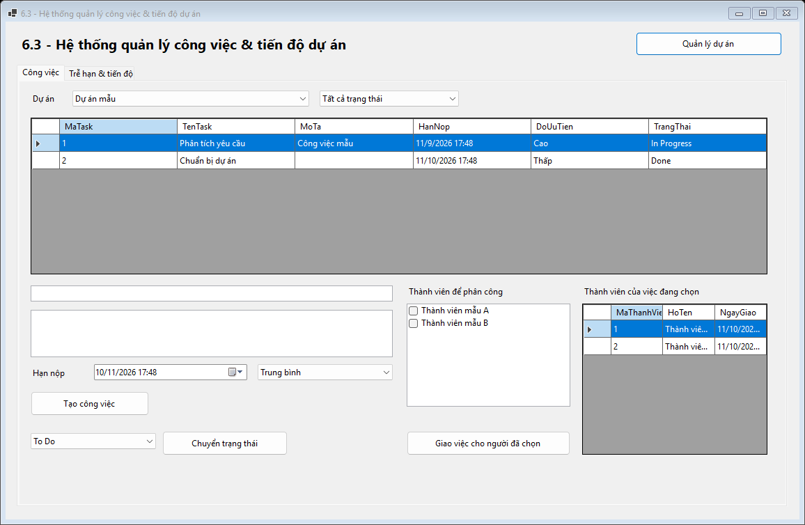
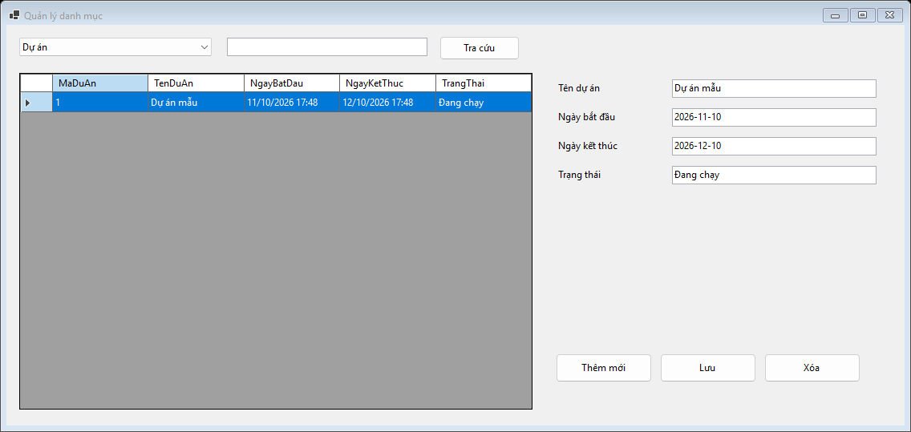
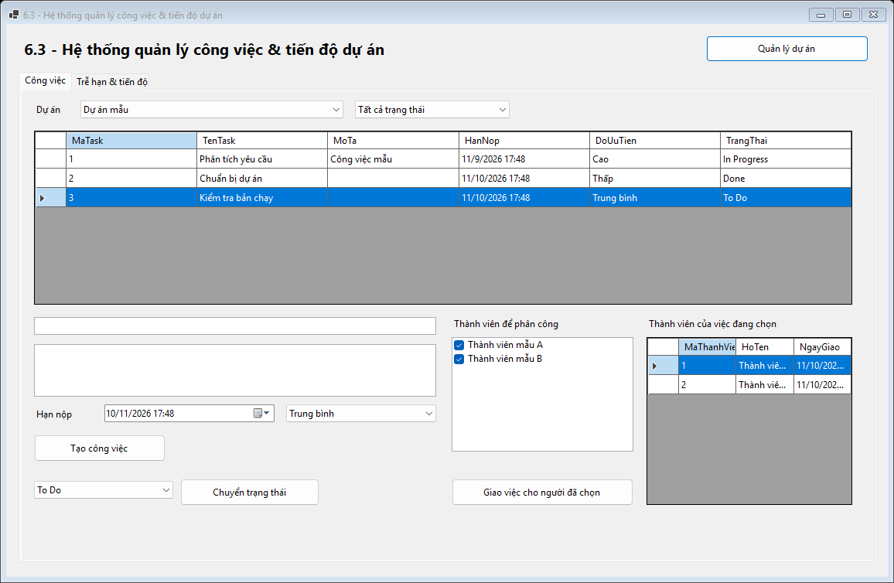
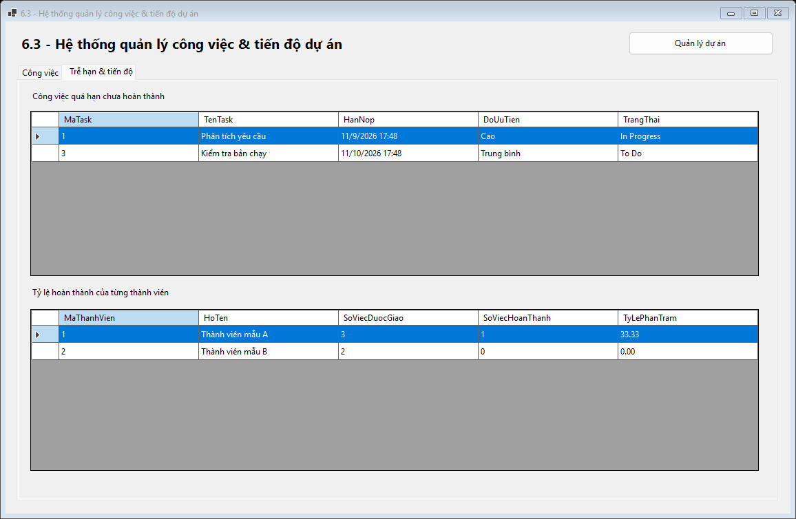
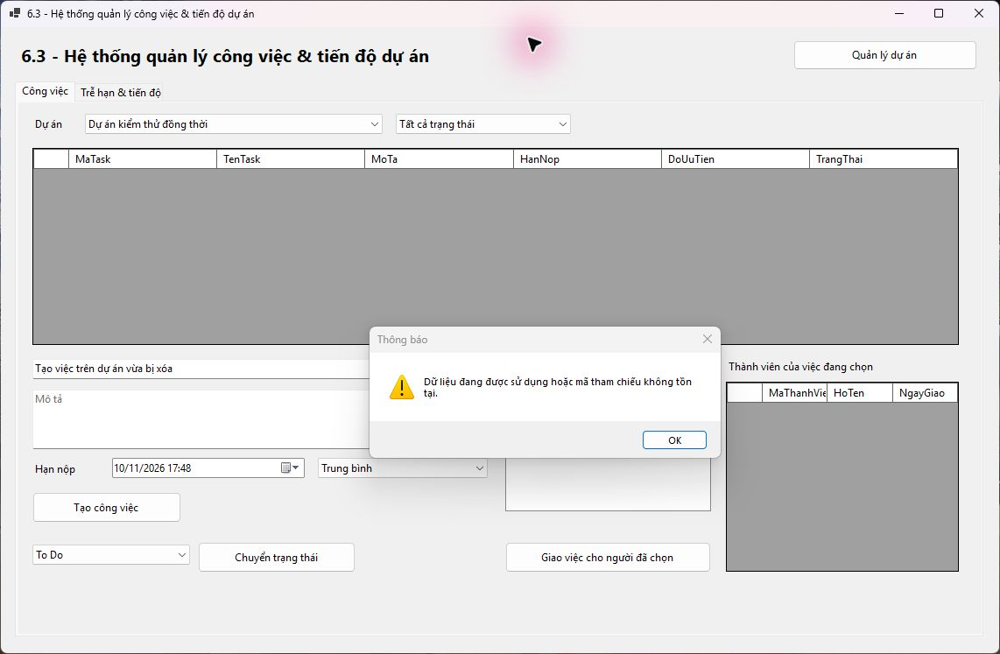

# Bài 6.3 - Hệ thống quản lý công việc & tiến độ dự án

## Mục 1. Thông tin sinh viên

- Họ và tên sinh viên: Phạm Tuấn Thành
- Mã sinh viên: 24810320264
- Lớp / Khóa: D19QTANM1

### Quy tắc đã thống nhất

Dùng chế độ danh sách, lọc theo dự án và bốn trạng thái To Do, In Progress, Review, Done. Thành viên mẫu dùng để phân công. Mỗi thành viên được tính tỷ lệ bằng số việc Done chia cho số việc được giao trong dự án. Việc giao nhiều người được tính riêng cho từng người. Dự án còn công việc sẽ bị chặn xóa.

### Cách chạy

1. Chạy [Database/ScriptDB.sql](Database/ScriptDB.sql) trên SQL Server để tạo CSDL ProjectTaskDB và dữ liệu mẫu.
2. Mở [ProjectTaskManagement.sln](ProjectTaskManagement.sln) trong Visual Studio có workload .NET desktop development và SDK .NET 8.
3. Kiểm tra cấu hình trong [DatabaseHelper.cs](ProjectTaskManagement/DAL/DatabaseHelper.cs). Máy chủ mặc định là (localdb)\MSSQLLocalDB. Nếu dùng máy chủ khác, sửa chuỗi kết nối theo máy chủ đã chạy script.
4. Nhấn **F5**. Để mở Design View, chọn MainForm.cs hoặc CatalogForm.cs trong Solution Explorer và nhấn **Shift+F7**.

## Mục 2. Hình ảnh kết quả các màn hình chức năng

### 1. Tổng quan công việc

### 2. Quản lý dự án

### 3. Tạo và phân công công việc

### 4. Công việc quá hạn và tỷ lệ hoàn thành

### 5. Giao dịch tạo việc bị từ chối khi dự án đã bị xóa

